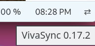
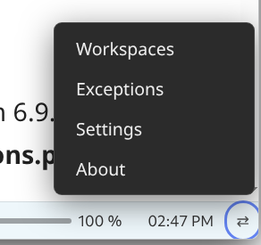
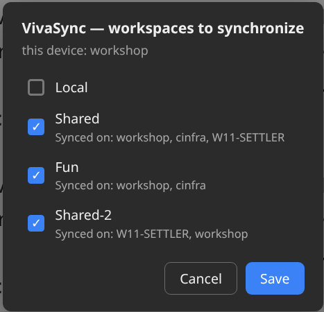
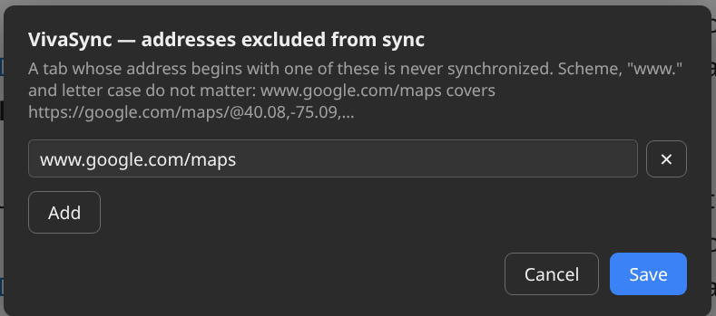
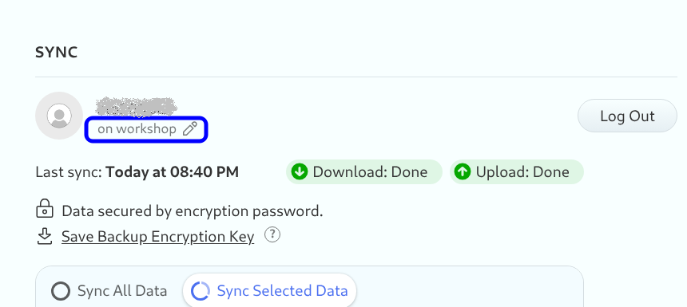
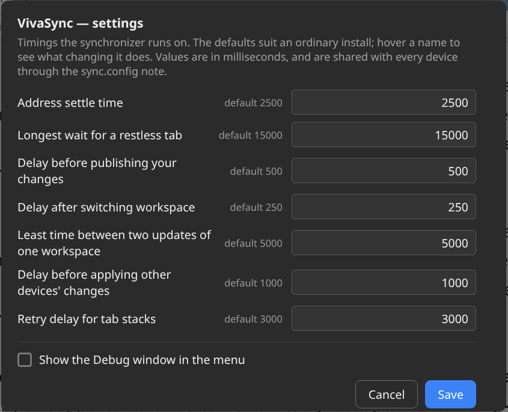

# Vivaldi Workspace Sync

VivaSync is a mod to Vivaldi browser providing a transparent, cross-device synchronization of selected Vivaldi **workspaces**
(their tabs, pinned state, tab stacks and tab-bar order) — similar in spirit to
MS Edge's workspace sync. Each device publishes its own view of a workspace and
reconciles against the newest view published by any other device following the Last Write Wins (LWW) strategy.

 Comparing to MS Edge workspace sync model this mod allows additional features
1. Selective workspaces synchronization configured on each machine. This allows a configuration with some workspaces synchronized across all user machines, ex: personal and work devices, while other workspaces may be synchronized only across personal devices, and another set of workspaces stay completely local on each device and not shared.
1. Specifying exception URLs to be excluded from the synchronization process so that even if there are tabs open with excluded URLs in a synchronized workspace they are ignored by synchronization logic and stay local. This is useful for Single Page Application sites with dynamic URL refresh logic like Google Maps.

Sync documents are **notes** in a `VivaSync` folder in Vivaldi Notes, so
**Vivaldi Sync itself is the transport** — no external file-sync tool, no native
host, no companion extension. The mod is the whole product.
> **Notes** Because the mod completely relies on Vivaldi built it synchronization mechanish **the synchronization logic is not real-time**. It operates withe some time lag following a polling cycle of Vivaldi synchronization logic. This is not a bug and considered to be normal for real life usage scenarios of such an application.
> To speed up the sync logic kicking of Vivaldy synchronization polling cycle one can open vivaldi://sync-internals page and click 'Trigger GetUpdates' button.


## Disclaimer
> 1. The mod is in early beta state, but already functional. I test it while I use it in my own daily work. There are some to fix for sure. Currently an issue I see there is in synchronization of tabs and stacks order which doesn't work correctly in all scenarios. Work on a fix is still in progress.
> 2. The mod was developerd and tested on Linux and Windows setups of Vivaldi browser only. It was never tested or installed on MacOS as I don't have one, all installation scripts for MacOS are AI generated (matching the same logic as Linux and Windows scripts), therefore review them and run in MacOS with caution, I appreciate any feedback from MacOS users if there are any bugs/issues requiring a fix.
> 3. The mod relies on Vivaldi internal undocumented features, there is no guarantee it will always work with future Vivaldi updates without a need of fixes/modifications.


## Requirements (Prerequisites)

**Vivaldi Sync must be enabled, with Notes included in the synced data types.**
Notes are the transport: with sync off, a device only ever sees its own document
and nothing crosses machines.

**Don't delete `VivaSync` folder in Vivaldi Notes** as it is vital for the mod to operate and normally its content is completely managed by the mod itself without a need for end user to intervent. Don't change anything in this folder and its notes unless you fully understand the mod logic and ready for development excercises with the synchronization logic.

**Ensure that local time is set correctly** on all machines with the mod installed and involved in the synchronization.

## Install
Download a packed release ...here...
Unzip the release archite to a local folder, open terminal or PowerShell console in the unzipped folder and run install-* script matching your OS.
> **Note** As it is usual with Vivaldi mods there is a need to reinstall the mod after each Vivaldi browser update.

### Install (Windows)

Run 
```powershell
./install-windows.ps1
```

### Install (Linux)

Run 
```bash
./install-linux.sh     # may prompt for sudo to edit main.html
```

Then restart Vivaldi. The installer copies the mod into the Vivaldi resources
dir and injects `<script src="vivasync-mod.js">` into **`main.html`** — the
"Vivaldi core" document that loads `bundle.js` and owns `chrome.*` + workspace
state.
(`window.html` is only a per-window render shell, so the mod must NOT go there;
CSS mods do, JS mods don't.)

> `main.html` lives in the root-owned Vivaldi install and is **overwritten on
> every Vivaldi update**. Re-run `./install-linux.sh` after updates. The
> resources dir defaults to `/opt/vivaldi/resources/vivaldi`; set
> `VIVALDI_RES=...` if yours is elsewhere.

### Install (macOS)
> **Disclaimer:** MacOS installation hasn't been tested! All MacOS Install/Uninstall scripts and instructions were AI generated and require manual verification. Use at your own risk.

Run 
```bash
./install-macos.sh              # re-signs the app bundle afterwards (see below)
./install-macos.sh --no-resign  # skip that step
```

Then quit Vivaldi completely (Cmd-Q) and start it again — closing the window is
not enough, the core document has to be re-read.

macOS keeps the same files inside the app bundle rather than in a system
directory:

```
/Applications/Vivaldi.app/Contents/Frameworks/Vivaldi Framework.framework/
    Versions/<build>/Resources/vivaldi/main.html
```

The installer finds that itself (`Versions/Current`, else the newest build) and
takes `VIVALDI_APP=/path/to/Vivaldi.app` or `VIVALDI_RES=...` if yours is
elsewhere — a Snapshot build, or an app in `~/Applications`.

> **Editing inside the bundle breaks Apple's code signature**, and a Vivaldi
> whose signature no longer matches its contents can refuse to start
> ("damaged and can't be opened") or lose its Keychain access. The installer
> therefore re-signs the bundle **ad-hoc** (`codesign --force --deep --sign -`)
> as its last step; that needs the Xcode command line tools
> (`xcode-select --install`). `--no-resign` skips it if you sign the bundle
> yourself.

> A Vivaldi update installs a **new** versioned framework beside the old one, so
> the injection goes with the version it was made in. Re-run
> `./install-macos.sh` after updates. `./uninstall-macos.sh` cleans **every**
> version present, not just the current one.


## Uninstall

Run `./uninstall-linux.sh`, `./uninstall-macos.sh` or `./uninstall-windows.ps1` to remove the injection and the copied script. Your sync data is **not** touched:
it lives in the `VivaSync` folder in Vivaldi Notes. Delete that folder in the
Notes panel to remove it — and note that doing so propagates to every device
via Vivaldi Sync.

## User Manual

### Accessing VivaSync Configuraion UI

The VivaSync mode UI is accessible through a new Vivaldi status bar **⇄** button which shows the current VivaSync version on hover over.


If you prefer to have Vivaldi main window status bar hidden you may still access VivaSync UI by clicking VivaSync **⇄** button at the bottom right corner of Vivaldi Settings dialog (Ctrl+F12) displayed in a floating circle.

> **Note** Normally the VivaSync button is injected inline in the Vivaldi status bar as illustrated above, however in some cases the VivaSync button may appear floating in a circle on top of the Vivaldi status bar. This is not a bug but a workaround to bypass some Vivaldi internal UI mechanics preventing status bar injection.
>
> 

### Menu

Either from the main Vivaldi window status bar or from its Settings screen click the **⇄** button in the status bar to open a VivaSync menu:


| Item | What it does |
|---|---|
| **Workspaces** | Tick the workspaces to sync, and see which devices share each one |
| **Exceptions** | Addresses that are never synchronized, however they are opened |
| **Settings** | The timings syncing runs on, and the switch that adds Debug to this menu |
| **About** | Mod name and version |

**Debug** is a fifth item, off by default: tick *Show the Debug window in the
menu* under **Settings** to get it. It shows status, diagnostics and the mod's
log without devtools, and is what a bug report should be copied from.

### Workspaces configuration

Choose **Workspaces**. It lists the workspaces on *this* machine; under each name
it shows the devices that synchronize it ("Synced on: workshop, cinfra"). The
tick box is **this device's** membership of that list — tick it to add this
machine, untick it to take this machine out. Every other device, and every
workspace this machine does not have, is left alone.



A workspace synchronizes between the devices that are ticked on it and no
others, so tick it on each machine you want it on. The workspace itself must
already exist there under the same name — VivaSync never creates a workspace.

On the sample configuration illustrated above there are three workspaces synced on this machine (workshop), one workspace (Shared) is synced with two other machines (cinfra and W11-SETTLER) and two other workspaces synced with only one other machine (Fun with cinfra and Shared-2 with W11-SETTLER). 

#### Adding this machine to a workspace other machines already sync

Workspaces are matched across machines by **name**, so joining an existing
synced workspace from a new machine takes three steps on that machine:

1. **Create an empty workspace with exactly the same name** as the workspace
   has on the other machines — same spelling, same letter case, same spaces.
   (If the name differs by a single character it is a different workspace, and
   you will start a new, separate sync instead of joining the existing one.)
2. **Open ⇄ → Workspaces, tick that workspace and Save.** The line under its
   name already lists the machines that sync it ("Synced on: …"); after saving,
   this machine is added to that list for every device. If the new workspace
   is not listed yet, or shows as *New workspace*, close the dialog and open it
   again — Vivaldi can take a moment to publish a new workspace's name.
3. **Stay in (or switch to) the new workspace and let synchronization bring the
   tabs in.** The tabs, stacks, pins and order from the other machines are
   applied the moment the workspace is open — immediately if you are already
   in it when you save, otherwise as soon as you switch into it. On a machine
   that has only just been signed in to Vivaldi Sync, the other machines'
   documents may still be arriving; the tabs then appear on their own as soon
   as they land, with no further action.

Why the workspace should be empty: when a machine joins a workspace other
machines already share, **the shared content wins and whatever the joining
machine had in that workspace is replaced**. VivaSync does this on purpose, so
that a newcomer can never overwrite what the others hold — but it means any
tabs you open in the new workspace before the first synchronization are
closed. An empty new-tab page is the exception: it is never synced and never
closed. Once the tabs have arrived, changes flow both ways as usual.

The selection is stored in the `VivaSync/sync.config` note, which you can review and also
edit by hand in the Notes panel (though manual editing is strongly not recommeded unless you are not a developer trying to debug the mod logic):

```json
{
  "workspaces": [
    { "name": "Work",     "peers": ["workshop", "cinfra"] },
    { "name": "Personal", "peers": ["workshop"] }
  ],
  "exceptions": [ "www.google.com/maps" ]
}
```

Names must match the Vivaldi workspace names exactly, and `peers` entries the
device names (the Workspaces dialog's subtitle tells you this device's name).
After editing the note by hand, run `VivaSync.reloadConfig()` (or just wait — a
synced change to the note is picked up automatically).

Because `sync.config` is itself a note, it replicates: there is one document and
every device reads the same one. That is what lets each machine show who a
workspace is shared with, rather than only its own opinion of it.

### Exceptions — addresses that never sync

Some tabs are worth having in a synced workspace without having them mirrored:
a map you pan around on each machine separately, a page whose address encodes
a session. This is specifically actual for such sites like Google Maps that the mod fails to properly synchrnize. If you encounter issues with any such a website choose **Exceptions** and add the beginning of the address, one per
row — `www.google.com/maps` is enough for every Google Maps view. Scheme,
`www.` and letter case do not matter, and the match is a prefix:
`https://google.com/maps/@40.08,-75.09,2968m/…` and `http://www.google.com/MAPS/place/x`
are both covered, `https://www.google.com/search?q=maps` is not.



A tab whose address begins with an exception is left exactly where it is on
every device: it is not written into this device's document, it is not closed
because a peer's document lacks it, and a peer's document that still lists it
does not open it here. A stack of one ordinary tab and one excepted tab is
synchronized as the ordinary tab alone; the stack stays intact locally. The
list is shared, like the rest of `sync.config`: an address excluded on one
machine is excluded on all of them. Removing an exception puts the tab back
into sync at the next write.

One thing to know when adding an exception for a tab that is *already* synced:
the other machines may receive the document without it before they receive the
new list, and then close their copy of the tab once. Nothing else is touched.

## First-run verification 
> **Note** This is a quick check sacenario for an end-user without programming skills. For those who wants a deeper dive in technical details please refer to [`CONTRIBUTING.md`](CONTRIBUTING.md)

Tick a real workspace under ⇄ → Workspaces, switch to it, and add/close a tab.
Open the **Notes panel**: a `VivaSync` folder should hold `sync.config` and a
`<workspace>-<device>.json` note whose content updates as you change tabs.

If it does, the mod is loaded and syncing. 

## How the Mod works

- **On change** (tab opened/closed/moved/pinned, stack added/removed/renamed/
  recolored, tab moved in/out of a stack) in a synced workspace, the mod writes
  the note `<workspace>-<device>.json` with `items` — the **ordered tab-bar
  sequence** of top-level tabs and stacks interleaved as they appear (each
  stack carries its optional name and colour, and its ordered member tabs) —
  and its provenance: `origin` (the device whose user made the state) and
  `version` (a logical clock). Newest-wins compares versions, not wall clocks,
  and a device never applies a document that names itself as the origin: its
  own change coming back through a peer is not the peer's change.
- **On opening a workspace**, and whenever Vivaldi Sync delivers a peer's note,
  the mod reads every `<workspace>-*.json` note; if a peer's document out-ranks
  the state this device holds, it reconciles: removes tabs/stacks not in the
  newer document, creates the missing ones, applies pin state, names and
  colours in place, and moves tabs and stacks into the document's order — then
  rewrites its own note. Tabs this device has that its own last note did not
  list yet — opened, or **moved in from another workspace** ("Move to
  workspace" switches into the target, which pulls whatever a peer changed
  there meanwhile) — are kept on top of the newer document, and the combined
  state is published back, so neither machine's changes are lost.

`<device>` comes from your Vivaldi Sync session name (the device name shown in
Vivaldi's Sync settings), so the notes are recognisable in the Notes panel.



Identity rules:
- **Tab** = `(container, url)` — container is top-level or a specific stack.
  URLs are compared normalised (`www.`, a trailing slash, host case and default
  ports ignored), so a site that redirects to another spelling of its own
  address does not make two machines fight over the tab.
- **Stack** = matched across devices by **name** (else by member-URL overlap).
  Stack `group` ids are assigned by Vivaldi's backend (not chooseable by the
  mod) so they differ per device; the id in the JSON is informational. Matching
  by name/contents keeps **unnamed stacks** as real stacks and makes a
  **rename** a non-destructive change rather than delete + recreate.
- A **stack's name and colour sync** — rename a stack or give it one of
  Vivaldi's stack colours and the other devices apply it to the stack they
  already have, in place. A document that says nothing about a stack's colour
  leaves the colour you set alone rather than clearing it.
- An **empty new tab is not synced** — neither published nor closed. Its address
  is a start page that differs between devices and is about to change anyway, so
  syncing it just makes two machines fight over an empty tab.
- A **stack of one is not a stack** — Vivaldi dissolves a stack once it drops
  below two tabs, so the survivor is published as an ordinary tab and a peer
  never rebuilds the stack you just took apart.
- Moving a tab into or out of a stack on one device **moves** it on the other
  rather than closing and re-opening it, so its history and scroll position
  survive the round trip.
- **Pinning syncs, for a tab and for a whole stack** — pin or unpin a tab and
  it pins in place on the other devices; pin a tab *stack* and it arrives as a
  pinned stack, not as a handful of loose pinned tabs.
- A **pinned tab is not a member of a stack that is not pinned.** Vivaldi drops
  a new tab into the stack the user is sitting in, pinned or not, which leaves a
  group where some tabs are pinned and some are not — the mod takes the odd ones
  back out, on every device, so a pinned tab arriving from a peer never becomes
  the first member of the stack next to it.
- **Tab-bar order syncs** — dragging a tab or a stack to a new place is a
  change like any other, and the other devices move theirs to match, with as
  few moves as possible (a stack always moves as one block). This includes the
  order of tabs *inside* a stack, and a tab opened from a link, which Vivaldi
  places next to the tab you clicked in: it arrives in that same place on the
  other device. One order stays per device: the order of the pinned strip,
  pinned stacks included.

The full rules, with the reasoning behind each, are in
[`docs/SPEC.md`](docs/SPEC.md).

## Settings — the timings, if you need to change them

> **WARNING! Be cautious tuning these values, try only if defaults do not work for you and be aware of what you change. Issues caused by missconfiguration of these timings cannot be considered as bugs.**

The defaults suit an ordinary install and there is no need to touch them. When
one does not — a machine where a site keeps publishing half-typed addresses, or
one you would rather have write to the Notes store less often — choose **⇄ →
Settings**. Each field says, on hover, what it does and which way to move it for
what you are seeing; the tick box at the bottom adds the **Debug** window to the
menu.



Saving writes only what you actually changed: a field left at (or put back to)
its default is removed from the note rather than written, so the note stays a
short list of this install's differences. A value that is not a number keeps the
dialog open and says which field it was, and an empty field means "use the
default".

The same values can be edited by hand in the `settings` object of the
`sync.config` note. It is shared like everything else there, so you set it once
for every device:

```json
{
  "workspaces": [ { "name": "Work", "peers": ["workshop", "cinfra"] } ],
  "settings": { "urlSettleMs": 4000, "minNoteWriteGapMs": 10000 }
}
```

| key | default | what it does |
|---|---|---|
| `urlSettleMs` | 2500 | how long a tab's address must hold still before it is published. Raise it if half-typed addresses reach the other machines on a site that rewrites its URL as you type; lower it for snappier syncing |
| `maxSettleHoldMs` | 15000 | how long that wait may last before the tab is published anyway, so a page that rewrites its address on a timer cannot stop the workspace syncing |
| `writeDebounceMs` | 500 | how long a burst of tab changes is collected before it is written |
| `switchDebounceMs` | 250 | the same, for the flurry of events a workspace switch produces |
| `minNoteWriteGapMs` | 5000 | the least time between two writes of the same note. Every write rewrites Vivaldi's Notes store and pushes a sync entity, so this is the main cost knob |
| `remoteDebounceMs` | 1000 | how long incoming changes from other devices are collected before acting on them |
| `groupSettleRetryMs` | 3000 | how long to wait before retrying a write when Vivaldi has not finished forming a tab stack |
| `showDebug` | `false` | whether the menu offers the **Debug** window (the dialog's tick box) |
| `logMax` | 400 | lines kept in the log the Debug window shows — note only, not in the dialog |
| `logLineMax` | 2000 | characters kept per log line — note only, not in the dialog |

Every key is optional; anything you leave out keeps its default, and removing
the object puts everything back. A value that is not a number (or is negative)
is ignored in favour of the default and says so in the log — as does a
misspelled key, which would otherwise do nothing silently. The Debug window's
first row names whatever an install has changed, so a bug report says which
timings were in force.


